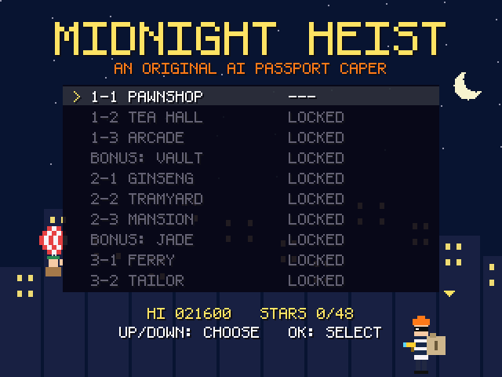
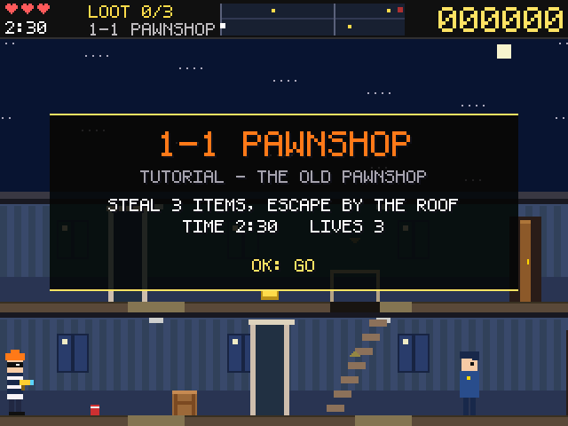
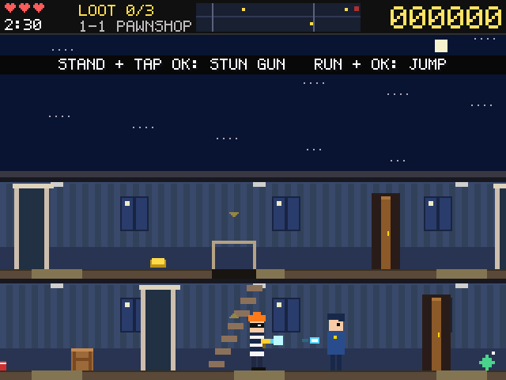
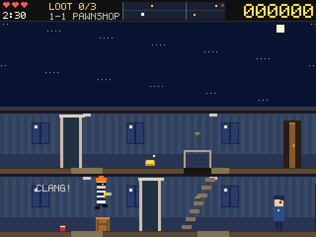
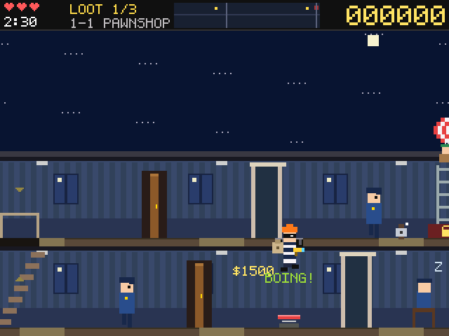
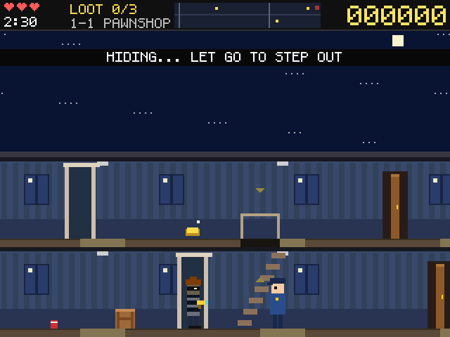
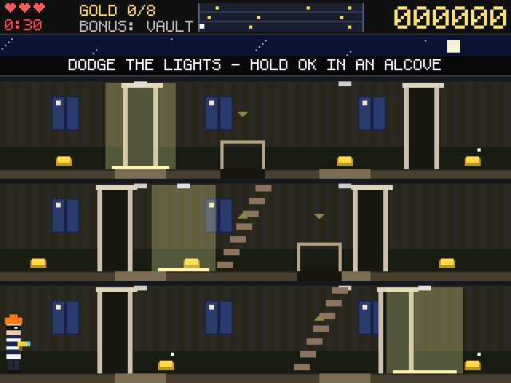
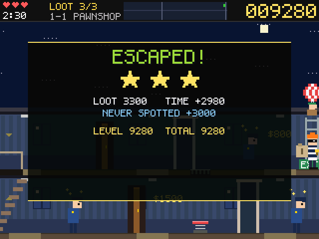
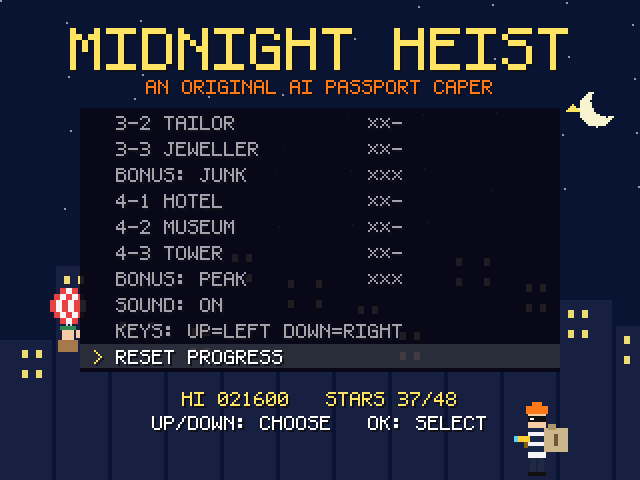
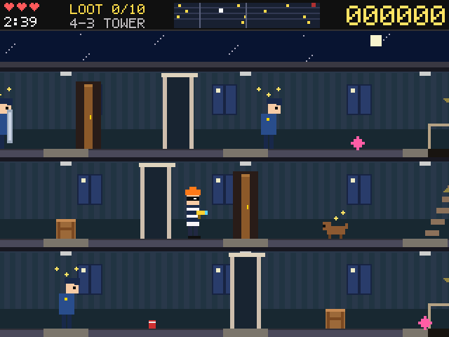

# AI Passport — Midnight Heist 午夜神偷

An original side-scrolling stealth caper for the **AI Passport** board
(ESP32-C3). You play 高佬, a lanky cat burglar in a striped jumper: sneak
through twelve Hong Kong buildings at night — a pawnshop, a dim-sum hall,
an arcade, a tram depot, a ferry pier, a bank tower and more — grab every
piece of loot, then climb to the roof where your partner 肥仔 waits in a
hot-air balloon. Hide in alcoves, slam doors on guards, jump crates and
banana peels, ride springboards, and zap guards with a toy-like stun gun
(it only makes them see stars for a few seconds). Three keys, 320x240,
chiptune sound, a fixed 30 updates a second, no PSRAM.

It is a homage to the *genre* of 1990s arcade heist games, not a copy: the
characters, names, art, music and levels are all original and procedurally
drawn. No assets, names or music from any commercial game are used.

The game installs into the board's second app slot (`ota_1`), next to the
AI Passport assistant (ai-passport-muse) in `ota_0`, and never rewrites the
assistant's bootloader, partition table or NVS.

**Status:** 16 stages (12 levels + 4 bonus stages), played strictly in
order. Every map passes the level validator; 97 rule checks pass in the host
harness (including an autopilot that clears every stage with the real
controls) and 79 in the browser prototype. Builds clean with ESP-IDF v6.0.1.

| | |
|---|---|
|  |  |
|  |  |
|  |  |
|  |  |
|  |  |

## Controls

The keys are one resistor ladder, so the board sees one key at a time and
there are no combinations. OK does four jobs, chosen by whether you are
moving and how long you hold it (the same feel as Pip's Passport: let go of
the direction, then press OK, and the speed carries into the jump):

| Situation | Press | Result |
|---|---|---|
| Moving (or still gliding < 0.15 s after letting go) | OK | **Jump at once**, keeping your speed: a run-up jumps farther. Holding OK lowers gravity while rising: hold longer, jump higher (up to the ceiling) |
| Standing at the exit, stairs or a door | tap OK (≤ 0.18 s) | **Context**: escape (all loot needed) → stairs → open / close the door (a guard behind it is flattened) |
| Standing anywhere else | tap OK | **Stun gun**: a slow glowing pellet (220 px/s, 130 px range, 0.6 s cooldown) |
| Standing at an alcove | hold OK | **Hide** at once; let go to step out |
| Standing elsewhere | hold OK > 0.18 s | **Jump on the spot** |
| In the air | UP / DOWN | steer a little |
| Walking into a wall for 1.5 s | — | **Pause** (a PAUSE meter fills) |

UP / DOWN walk left / right (swap with **KEYS**). Double-tap was rejected: it
delays every tap by 0.2–0.3 s, which makes shooting and doors feel sticky.

## Rules

- **Guards** patrol, sleep, investigate noises, and when their spot meter
  fills (0.45 s in view) they chase and fire sleepy darts at knee height —
  a held jump clears a dart. Closed doors block sight, darts and pellets.
- **Shield guards** block pellets from the front; zap them from behind or
  slam a door on them. **Dogs** charge; the stun gun only holds them 3 s.
- **Noise**: a kicked can, a banana slip, a door slam and the pop where a
  pellet lands bring guards on that floor to look.
- **Crates** (14 px) block the way: jump over or onto them. **Banana
  peels** make you slide and yelp unless you jump them. **Springboards**
  bounce you through the hatch into the floor above.
- **Getting caught** (dart, dog, guard, a door opened into you) costs a life
  and drops **only the last item** you picked up, just behind you.
- **Timer** per level (2:15–2:40, bonus 30–42 s, shown on the intro card); 3 lives. Score: loot, +20 per second left,
  +3000 if never spotted, +100 per stun, +300 per door slam; 1–3 stars.
- **Bonus stages**: grab the gold bars while spotlights sweep. They never
  cost a life; finishing (all the gold or time up) opens the next level.
  Stars: 3 for all the gold, 2 for two thirds, otherwise 1.
- **Progress**: levels unlock strictly in order; escaping level *n* opens
  *n+1*. High score, the furthest unlocked level, best stars per level,
  sound and key swap are saved in NVS namespace `heist` (blob `progress`)
  and survive a reboot. **RESET PROGRESS** at the bottom of the title menu
  asks for a second OK (moving the cursor cancels), then locks everything
  but 1-1 and clears the stars; the high score is kept.

## Levels

The level select lists every stage; locked ones are greyed and say
**LOCKED** (choosing one says which level to clear first). The cursor starts
on the furthest unlocked level. Buildings with 4 floors are taller than the
screen: the view shows 3 floors plus the roof and glides up and down to
follow the thief (fixed rooms keep the old layout).

| # | Stage | Floors × cols | Loot | Guards / shield / dogs / asleep | Doors / crates / cans / peels / springboards | Time |
|---|---|---|---|---|---|---|
| 1 | **1-1 Pawnshop** 大押 (tutorial) | 2 × 32 | 3 | 2 / 0 / 0 / 1 | 2 / 1 / 1 / 0 / 1 | 2:30 |
| 2 | **1-2 Tea Hall** 茶樓 | 2 × 38 | 4 | 2 / 0 / 0 / 1 | 2 / 1 / 2 / 0 / 0 | 2:30 |
| 3 | **1-3 Arcade** 機舖 | 3 × 40 | 4 | 2 / 0 / 1 / 1 | 3 / 2 / 2 / 1 / 1 | 2:30 |
| 4 | **Bonus: Vault** 金庫 | 3 × 20 | 8 bars | 3 spotlights | — | 0:30 |
| 5 | **2-1 Ginseng Shop** 參茸海味舖 | 3 × 42 | 5 | 2 / 1 / 0 / 2 | 3 / 2 / 2 / 1 / 0 | 2:30 |
| 6 | **2-2 Tram Depot** 電車廠 | 3 × 46 | 5 | 4 / 1 / 1 / 0 | 3 / 2 / 1 / 2 / 2 | 2:30 |
| 7 | **2-3 Mansion** 富豪大宅 | 3 × 44 | 5 | 3 / 1 / 1 / 1 | 5 / 3 / 3 / 2 / 1 | 2:15 |
| 8 | **Bonus: Jade Market** 玉器市場 | 3 × 26 | 8 bars | 3 spotlights | — (1 crate) | 0:30 |
| 9 | **3-1 Ferry Pier** 渡輪碼頭 | 3 × 50 | 6 | 4 / 1 / 1 / 1 | 4 / 2 / 2 / 2 / 0 | 2:30 |
| 10 | **3-2 Tailor** 洋服店 | 3 × 52 | 6 | 4 / 2 / 2 / 1 | 4 / 2 / 2 / 1 / 1 | 2:20 |
| 11 | **3-3 Goldsmith** 金舖 | 4 × 44 | 7 | 4 / 2 / 1 / 1 | 4 / 3 / 2 / 2 / 0 | 2:20 |
| 12 | **Bonus: Junk** 帆船貨艙 | 3 × 30 | 9 bars | 3 spotlights | — (1 crate) | 0:35 |
| 13 | **4-1 Harbour Hotel** 海景酒店 | 4 × 50 | 8 | 5 / 2 / 1 / 1 | 5 / 3 / 2 / 1 / 1 | 2:30 |
| 14 | **4-2 Museum** 博物館 | 4 × 56 | 9 | 5 / 2 / 2 / 1 | 6 / 3 / 2 / 2 / 1 | 2:30 |
| 15 | **4-3 Bank Tower** 銀行大廈 | 4 × 60 | 10 | 6 / 3 / 2 / 1 | 7 / 3 / 2 / 2 / 1 | 2:40 |
| 16 | **Bonus: Peak Vault** 山頂寶庫 | 4 × 28 | 10 bars | 4 spotlights | — | 0:42 |

(In-game names are the short English ones, e.g. `3-3 JEWELLER`, `4-3 TOWER`.)

Levels live in `tools/gen_levels.py` (one character per 16 px column). Before
`main/levels.c` and `prototype/levels.js` are written, every map is checked:

- **Structure**: the firmware's array limits, stairs and springboard/hatch
  pairs, door and alcove placement, crates with room for a run-up and at
  least 3 columns from stairs, doors and the exit.
- **Reachability and solvability**: a route graph over walking, stairs,
  doors, jumps and springboards; every item and the exit must be reachable,
  and the shortest route collecting all loot and escaping is solved exactly.
- **Time pressure**: (route + an allowance per guard) / timer must stay at
  or under 85 % (bonus 80 %).
- **Difficulty curve**: threat (guards, dogs, shields, hazards, size) and time
  pressure never go down from one level to the next.

`python3 tools/gen_levels.py --check` validates without writing and prints
the table. The host harness then plays every stage with an autopilot using
the real key handling (guards stunned, spotlights off); its clear times run
from 12 s (1-1) to 115 s of 160 s (4-3).

## Memory and performance

- **No `malloc` after start-up.** The whole level, thief, guards, pellets,
  darts and pop-up texts live in one static `world_t` of **1.7 KB** (sized
  for the biggest map: 4 floors × 64 columns, 12 guards). Maps are `const`
  in flash and the world is rebuilt in place when a
  level starts; nothing is allocated in the game loop.
- **No sprite bitmaps:** every character and prop is drawn from rectangles
  at run time (`main/art.c`); flash holds only the 5x7 font and the maps.
- The screen is drawn in 6 bands of 40 rows into two 25 KB buffers while DMA
  sends the previous band. Play frames skip the band clear (HUD, sky and
  floors cover every pixel), floors outside a band are skipped, palette
  shades are mixed once per level, and only the bonus spotlights blend.
- Pause / result screens redraw only on change; logic runs on a fixed 1/30 s
  step with up to 3 catch-up steps.

Build figures (ESP-IDF v6.0.1, `-O2`, `idf.py size`, 2026-10-10):

| | |
|---|---|
| App image | 0x71000 (452 KB padded, 407 KB used) of a 0x3E0000 slot, 89% free |
| Flash | 277 KB code, 78 KB read-only data (game code 43 KB, game data 3.8 KB incl. all 16 maps) |
| Static DRAM | 65.8 KB (.bss 58.7 KB incl. 50 KB band buffers + 1.7 KB world; .data 7.1 KB) |
| IRAM code | 52.8 KB |
| Left for heap and stacks | ~198 KB |

Per frame: a busy play frame is ~152k pixel writes (4-floor tower with 12
guards ~147k, bonus frame ~176k), roughly 2–4 ms of drawing at 160 MHz;
sending a full frame over 40 MHz SPI takes ~31 ms, so SPI, not drawing, sets
the 30 fps ceiling. Every 10 s the firmware logs fps, late frames, render time
and free heap.

**Measured on the board (2026-10-10, title screen):** 30.0 fps, 0 late
frames, free heap 251 KB (minimum 251 KB), world 1672 bytes. A full title
frame takes 31–36 ms, so the title redraws at 15 fps (a key press redraws at
once) while input and logic stay at 30 Hz. Play frames still need measuring
in a real session; if they run late, try `BOARD_LCD_PCLK_HZ` at 80 MHz in
`main/board.h`.

## Build

Needs ESP-IDF v6 and the assistant's signing key (never committed).

```sh
. ~/esp/esp-idf-v6/export.sh
cp ../ai-passport-muse/esp32/dev_signing_key.pem .
idf.py -B build -DIDF_TARGET=esp32c3 build
idf.py -B build size
```

Output: `build/ai-passport-heist.bin` (signed).

## Flash: use tools/flash.sh only

> **Never run `idf.py flash`.** It rewrites the bootloader, partition table
> and otadata, which breaks the assistant.

```sh
tools/flash.sh -p /dev/cu.usbmodem*            # write ota_1 only
tools/flash.sh -p /dev/cu.usbmodem* --boot     # ...and make ota_1 the boot slot
```

`ota_1` is shared with the other AI Passport games (Pip's Passport, Fire
Brigade): only one of them is on the board at a time. **BACK TO ASSISTANT**
on the title or pause menu returns to the assistant.

## Tools

| | |
|---|---|
| `prototype/index.html` | browser prototype (same rules, maps and progress); open it directly (keep `levels.js` beside it) |
| `tools/proto_test.sh` | 79 rule checks on the prototype in headless Chrome |
| `tools/gen_levels.py` | maps → `main/levels.c` + `prototype/levels.js`, with the validator |
| `tools/gen_assets.py` | 5x7 font → `main/assets.c` |
| `tools/shots/make_shots.sh` | host build of the real game code: 97 rule checks (incl. autopilot on every stage, progress/locks/reset across a simulated reboot) + `docs/*.png` |
| `tools/flash.sh` | writes `ota_1` only |

Plan and design notes (Cantonese / English): [PLAN.md](PLAN.md).
